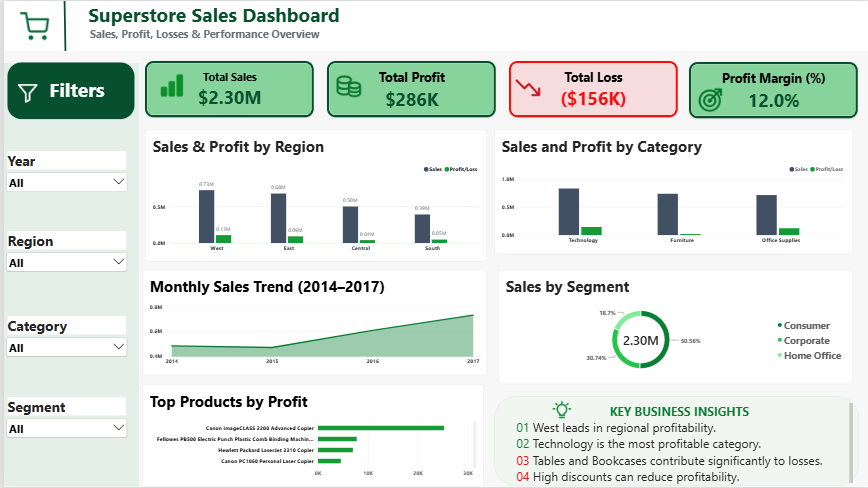

# Superstore Sales Dashboard | Power BI

An interactive retail analytics dashboard built with **Microsoft Power BI** to explore Superstore sales, profitability, losses, customer segments, and product performance from **2014–2017**.

## Dashboard Preview




## Project Overview

This project turns a Superstore sales dataset into a one-page dashboard that helps answer practical retail business questions: Where is revenue strongest? Which categories generate the most profit? Which products contribute the most profit or loss? How does performance change over time?

The report provides an at-a-glance view of business performance alongside interactive filters for **Year**, **Region**, **Category**, and **Customer Segment**.

## Business Questions

- How much revenue and profit did the business generate?
- How much profit was lost on unprofitable transactions?
- Which regions and product categories perform best?
- How do sales change over time?
- Which customer segments contribute the most sales?
- Which products generate the highest profit?

## Tools and Skills

- **Microsoft Excel:** data inspection, cleaning, standardizing dates, calculating performance metrics, and preparing the source file.
- **Power Query:** data import, column types, and transformation checks.
- **Power BI Desktop:** report design, charts, KPI cards, and interactive filters.

## Dataset

- **Source:** Superstore retail transactions used for this learning project.
- **Period:** 2014–2017.
- **Records:** 9,994 transaction-line records (excluding the header).
- **Example fields:** Order Date, Ship Date, Region, Category, Sub-Category, Product Name, Segment, Sales, Quantity, Discount, and Profit.

The source file initially required attention to date interpretation and empty-row/import issues. It was cleaned and its performance metrics were calculated in Excel before importing into Power BI. Dates in the original source use the **month/day/year** format.

**Data sharing note:** Include the dataset in this public repository only if its license or original source permits redistribution. Otherwise, link to the dataset source and describe the fields.

## Key Performance Indicators

The completed dashboard presents these approximate full-dataset values (with no slicers applied):

| KPI | Approximate result | Definition |
| --- | ---: | --- |
| Total Sales | **$2.30M** | Sum of Sales |
| Total Profit | **$286K** | Sum of Profit |
| Total Losses | **$156K** | Magnitude of negative-profit transactions |
| Profit Margin | **12.0%** | Profit-margin figure calculated in Excel and displayed in the report |


## Dashboard Components

1. **KPI cards** — Total Sales, Total Profit, Total Losses, and Profit Margin.
2. **Sales & Profit by Region** — comparison across West, East, Central, and South.
3. **Sales & Profit by Category** — comparison across Technology, Furniture, and Office Supplies.
4. **Sales Trend (2014–2017)** — sales performance over time.
5. **Sales by Segment** — contribution from Consumer, Corporate, and Home Office customers.
6. **Top Products by Profit** — leading profitable products.
7. **Key Business Insights** — concise findings and business considerations.
8. **Interactive slicers** — Year, Region, Category, and Segment.

## Data Preparation and Calculations in Excel

Data cleaning and metric calculations were completed in **Microsoft Excel** before importing the cleaned workbook into Power BI. The process included:

- Checking and standardizing **Order Date** and **Ship Date** fields.
- Removing unwanted empty records and preserving valid transaction rows.
- Preparing the **Sales**, **Profit**, **Loss**, and **Profit Margin (%)** columns.
- Reviewing the resulting KPIs in Power BI and presenting them as cards and charts.

The dashboard displays the **12.0% profit-margin result** from the Excel-based calculation. Power BI is used primarily for visualisation, filtering, and exploration of the prepared data.

## Insights and Recommendations

Based on the dashboard's overall comparisons:

- **West** has the strongest regional sales and profitability.
- **Technology** contributes the highest category profit.
- **Tables and Bookcases** deserve closer review because they include important loss-making products.
- **Discounting** should be assessed against profitability before expanding promotional offers.

These observations describe patterns to investigate; they are not proof that discounts caused losses. Validate product-level and discount-level findings with filtered visuals or further analysis before making business decisions.

## How to Open the Project

1. Install **Power BI Desktop**.
2. Download `Superstore_Sales_Dashboard.pbix` from this repository (if provided).
3. Open the `.pbix` file in Power BI Desktop.
4. If the source path is unavailable, go to **Transform data → Data source settings**, update the path to your local cleaned dataset, and refresh.
5. Use the Year, Region, Category, and Segment slicers to explore the results.


## Repository Contents

```text
superstore-sales-analysis/
├── README.md
├── Superstore_Sales_Dashboard.pbix   
├── dashboard_screenshot.png         
```

## What I Learned

This project strengthened my ability to clean imported data, troubleshoot Power BI data types, calculate performance metrics in Excel, create interactive visuals, and translate retail data into actionable business questions.


**Project type:** Data Analytics / Business Intelligence Portfolio Project  
**Tools:** Excel · Power Query · Power BI
